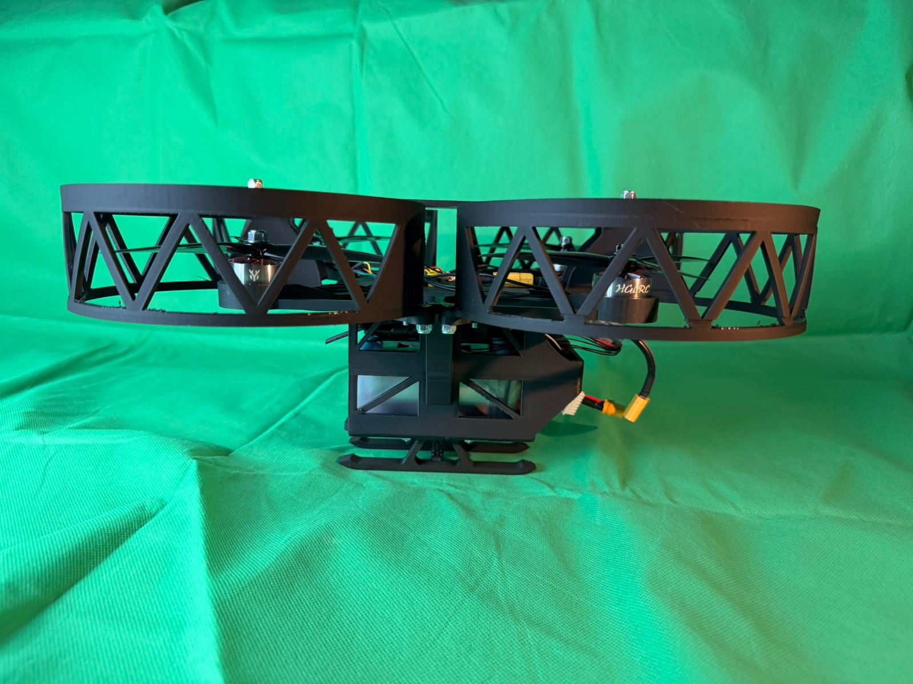
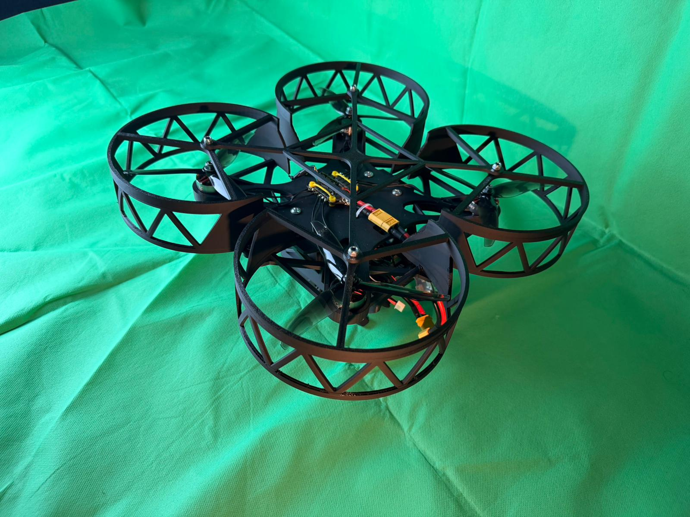
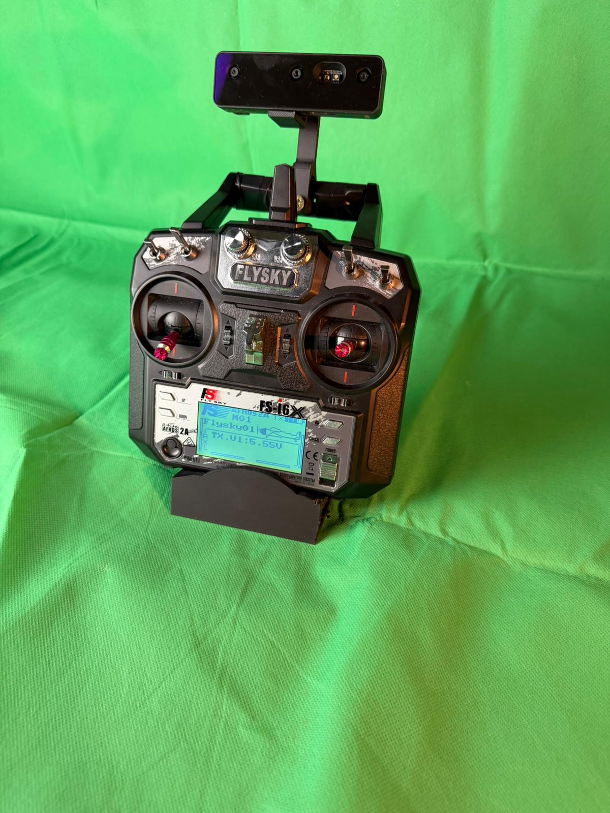
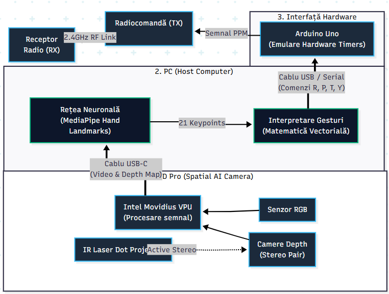
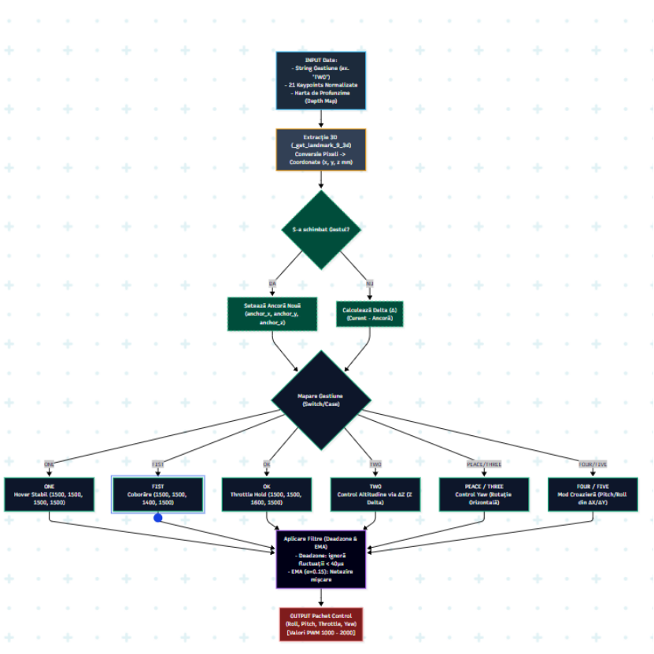
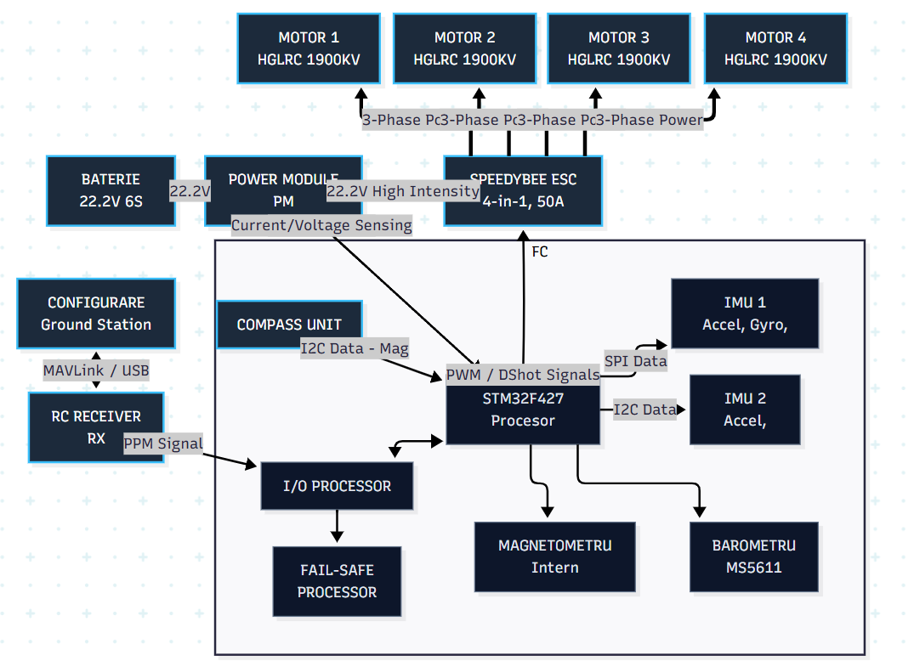

# HandFly

**Hand gesture control for a custom quadcopter, using OAK-D Pro, MediaPipe, and an Arduino-to-RC bridge.**

HandFly turns hand poses and movement into roll, pitch, throttle, and yaw commands. An OAK-D Pro camera captures RGB and depth data, Python recognizes the gestures, and an Arduino converts serial commands into a PPM signal for the radio control chain.



[Demo videos](#demo-videos) · [Hardware](#hardware) · [Architecture](#architecture) · [Getting started](#getting-started) · [Gesture controls](#gesture-controls)

## Demo videos

| Recording | Video |
| --- | --- |
| Flight demonstration | [Watch or download the flight demo](docs/media/flight-demo.mp4) |
| Functionality demonstration with a weight strapped to the drone | [Watch or download the weighted demo](docs/media/weighted-functionality-demo.mp4) |

The original MP4 recordings are included in the repository. Open either link to view or download the video.

## Hardware

<table>
  <tr>
    <td align="center" width="50%"></td>
    <td align="center" width="50%"></td>
  </tr>
  <tr>
    <td align="center">Custom quadcopter and rotor guards</td>
    <td align="center">Camera and radio transmitter assembly</td>
  </tr>
</table>

The supplied photos and architecture diagrams document this build:

| Component | Role |
| --- | --- |
| OAK-D Pro | RGB capture and active stereo depth sensing |
| PC / laptop | MediaPipe hand landmarks, gesture recognition, and command generation |
| Arduino Uno | USB serial to PPM bridge |
| FlySky FS-i6X transmitter and RC receiver | Radio link between the control station and aircraft |
| Pixhawk flight controller | Receives RC commands and drives the aircraft |
| 22.2 V 6S battery and power module | Power supply and voltage/current sensing |
| SpeedyBee 4-in-1, 50 A ESC | Motor control |
| Four HGLRC 1900 KV motors | Propulsion |

## Architecture

### Control path

```text
Hand → OAK-D Pro RGB + depth → Python / MediaPipe
     → gesture-to-channel mapping → USB serial → Arduino PPM
     → radio transmitter → receiver → Pixhawk → ESCs → motors
```



MediaPipe detects 21 hand landmarks. The application classifies finger poses and uses hand position or depth to calculate channel values. Commands are sent as text over USB serial; the Arduino emits the corresponding PPM channel pulses.

### Software flow



The diagram illustrates the gesture-processing flow. Exact mappings differ between the standalone and modular implementations; the [gesture table below](#gesture-controls) describes the current code. In particular, the modular controller currently disables depth-based throttle for `TWO`.

### Power and flight electronics



The original diagrams retain their Romanian labels. The power diagram shows the propulsion supply and flight-controller connections separately from the camera and host control path.

## Getting started

### 1. Install Python dependencies

From the repository root, create a virtual environment and install the application requirements. These commands use PowerShell:

```powershell
cd PythonProject
python -m venv .venv
.\.venv\Scripts\python.exe -m pip install -r requirements.txt
```

The dependency list is maintained in [PythonProject/requirements.txt](PythonProject/requirements.txt). It includes DepthAI, MediaPipe, OpenCV, NumPy, and pyserial.

The hand landmark model is included at [PythonProject/models/hand_landmarker.task](PythonProject/models/hand_landmarker.task). Run the application from `PythonProject` so its relative model path resolves.

### 2. Check the camera and run without serial output

Connect the OAK-D Pro over USB, then run:

```powershell
.\.venv\Scripts\python.exe probe_device.py
.\.venv\Scripts\python.exe main_modular.py
```

Omitting `--port` starts the application without Arduino serial output. The camera is still required. Use the live overlay to check hand recognition and channel values.

The standalone implementation is also available:

```powershell
.\.venv\Scripts\python.exe standalone_gpu.py
```

### 3. Set up the Arduino bridge

Open [arduin_code.ino](arduin_code.ino) in Arduino IDE and upload it to the appropriate board and serial port. The supplied sketch uses:

| Setting | Value |
| --- | --- |
| Serial baud rate | 115200 |
| PPM output | Digital pin **3** |
| PPM channels | **6** |
| Frame length | 20,000 microseconds |
| Pulse width | 400 microseconds |
| Channels 1–4 | Roll, pitch, throttle, yaw |
| Channels 5–6 | Fixed at 1000 microseconds |

Connect the PPM output and common ground to the transmitter's compatible PPM/trainer input, following the wiring for your hardware.

The serial protocol is one newline-terminated command per line:

```text
R:1500 P:1500 T:1250 Y:1500
```

The sketch clamps channel values to 1000–2000. After more than 500 ms without a valid command, it sets roll, pitch, and yaw to 1511 and throttle to 1005.

### 4. Run with serial output

List ports and replace `COM3` with the Arduino's port:

```powershell
.\.venv\Scripts\python.exe -m serial.tools.list_ports
.\.venv\Scripts\python.exe main_modular.py --port COM3
```

Both entry points accept `--gesture-hold` to set the number of consistent frames required to confirm a gesture; the default is 3.

## Gesture controls

The names below are the labels used by the recognizer. `OK` means **thumb extended with the other fingers folded**; `TWO` means **thumb and index extended**.

| Gesture | Hand pose | Modular application | Standalone application |
| --- | --- | --- | --- |
| `ONE` | Index extended | Center roll/pitch/yaw; throttle at `HOVER_THROTTLE` | Center all four channels at 1500 |
| `FIST` | All fingers folded | Center roll/pitch/yaw; throttle at `HOVER_THROTTLE - 100` | Center roll/pitch/yaw; throttle at 1400 |
| `OK` | Thumb extended | Fixed throttle at `HOVER_THROTTLE + 100` | Fixed throttle at 1600 |
| `TWO` | Thumb and index extended | Depth throttle disabled; uses `HOVER_THROTTLE` | Depth-relative throttle, limited to 1500–2000 |
| `PEACE` / `THREE` | Index + middle, optionally thumb | Horizontal hand position controls yaw in the 1250–1750 range | Same yaw range; throttle at 1500 |
| `FOUR` / `FIVE` | Four fingers / open hand | Hand displacement from a spatial anchor controls roll and pitch | Image-space hand position controls roll and pitch |

The modular controller currently sets `HOVER_THROTTLE = 1250` in [config.py](PythonProject/hand_pose/config.py). This makes its `OK` and `FIST` throttle values 1350 and 1150 respectively. The standalone implementation has its own constants and control logic.

These are RC channel commands: a fixed throttle value does not itself guarantee hover, altitude hold, or landing. Actual motion depends on aircraft calibration and the flight-controller mode.

### Keyboard controls

| Key | Action |
| --- | --- |
| `Q` | Quit either application |
| `R` | Request yaw recalibration |
| `P` / `G` | Switch the modular application to keyboard / gesture mode |
| `Space` | Send the arm command in modular keyboard mode |
| `W` / `S` | Increase / decrease keyboard throttle |
| `A` / `D` | Adjust keyboard yaw |
| `I` / `K` | Adjust keyboard pitch with held-key support |
| `J` / `L` | Adjust keyboard roll |

In the modular application, detected `ONE` and `FIST` gestures override keyboard commands. Held-key input uses the `keyboard` package; the OpenCV key-event fallback has more limited behavior.

## Configuration and troubleshooting

- **Camera connection:** run `probe_device.py`, check the USB connection, and inspect the startup output.
- **Model not found:** run from `PythonProject` and confirm `models/hand_landmarker.task` exists.
- **Serial connection:** check the port with `serial.tools.list_ports` and close other programs using it, including Arduino Serial Monitor.
- **OpenCV display errors:** review the GUI/headless package notes in `PythonProject/requirements.txt`.
- **Gesture switching or jitter:** adjust `--gesture-hold` and review the deadzones and cruise sensitivity in [config.py](PythonProject/hand_pose/config.py).
- **Unexpected channel behavior:** check which entry point is running. Changes to the modular controller do not automatically change `standalone_gpu.py`.

## Repository layout

```text
HandFly/
├── README.md
├── arduin_code.ino                 # Serial-to-PPM firmware
├── docs/media/                     # Build photos, diagrams, and demo videos
└── PythonProject/
    ├── main_modular.py             # Modular application and keyboard controls
    ├── standalone_gpu.py           # Standalone gesture-control implementation
    ├── main.py                     # Additional entry point
    ├── hand_pose/                  # Gesture, flight-control, pipeline, and serial modules
    ├── models/hand_landmarker.task # MediaPipe hand landmark model
    ├── probe_device.py             # Camera connection diagnostic
    ├── test_gestures.py            # Gesture diagnostic
    └── requirements.txt           # Application dependencies
```

## Project status

HandFly is a hardware prototype with flight and weighted-functionality recordings included above. The photos and videos document the build; the code and configuration define the behavior of each application variant.
